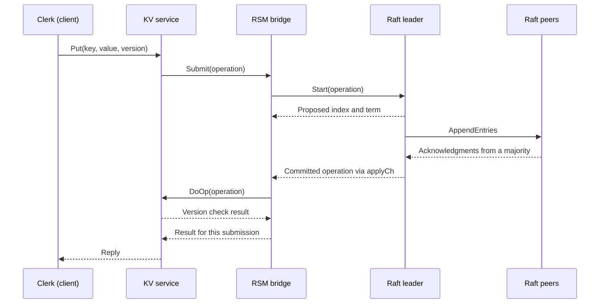

# raft-kv | Building consensus from the paper

I implemented Raft in Go and built a linearizable, versioned key/value service
on top. The project spans leader election, log replication, persistent protocol
state, Raft snapshots, and a replicated-state-machine bridge that turns committed
log entries into client responses.

The central challenge was preserving the meaning of a successful operation
across failures. A server can accept a write and lose leadership before replying.
A delayed message can arrive after the state it describes has changed. A client
can retry a write that already committed. Handling those cases requires the
consensus protocol, application state machine, and client to agree on what each
result actually establishes.

**[Live demo](https://dahalab1.github.io/raft-demo/)** ·
**[Full engineering story](docs/build-story.md)** ·
**[Source map](#source-map)**

The full story preserves the development history: failed approaches, debugging
traces, latency measurements, and the reasoning behind the implementation.

## What makes a write successful?

The service exposes `Get(key)` and `Put(key, value, version)`. Reads return a
value and its version. Writes compare the supplied version with the stored
version, update the value on a match, and increment the version. Version zero
creates a missing key. If two clients read version 7 and both submit an update,
only the first applied update can succeed with that version.

Each request crosses three layers:

`Start` accepts an operation into the leader's log. Its returned index is a
place to wait, not evidence of success: another leader could replace that entry
before it commits. The RSM associates each submission with a server identifier
and local sequence number, then checks the identity of the operation actually
applied at that index before returning its result.

Submission and waiter registration share a lock so a fast commitment cannot
outrun registration. Result channels are buffered so a caller that stops waiting
cannot block the reader and stall subsequent operations. A single reader applies
committed commands in order; that ownership also lets the KV map operate without
a separate mutex in the current implementation.

Reads take the same replicated path as writes. This gives each read an ordered
position relative to updates, with the explicit cost of consensus work for every
read. Progress requires a communicating majority and successful leader election.

[Implementation: RSM](kvraft/rsm/rsm.go) · [KV state machine](kvraft/server.go)

## What can the client know after a failure?

Suppose a write changes version 7 to 8, but its response is lost. The client
retries with version 7 and receives `ErrVersion`. Two histories explain that
response: its first write succeeded, or another client's write advanced the
version. The version check prevents the retry from applying the same conditional
update again, but cannot tell the client which history occurred.

The Clerk preserves that distinction. A version mismatch on the first attempt
returns `ErrVersion`. After an unanswered attempt, a later mismatch returns
`ErrMaybe`.

Leadership changes introduce the same uncertainty. The RSM checks its original
term and leadership every 100 milliseconds while waiting. If leadership changes,
it can return `ErrWrongLeader` even though the operation may still commit.
Consequently, the Clerk treats that response as an uncertain attempt too.

This was a correctness issue across layers: interpreting a routing error as
proof that a write never executed gave the application a false result. The fix
makes some unsuccessful writes ambiguous as well, because the client lacks the
information to distinguish them safely. The Clerk retries across servers and
remembers the last responding leader; its retry loops have no deadline.

[Implementation: Clerk](kvraft/client.go) ·
[The debugging story](docs/build-story.md#chapter-6--the-kv-store-linearizability-at-the-edge)

## How does replication handle messages from the past?

A follower might receive entries through index 12, then receive an older request
containing entries only through index 10. Truncating its log at the end of the
older request would destroy a valid suffix. `AppendEntries` compares entries
and truncates only where the same index contains a different term. Matching
entries leave the existing suffix intact.

The leader must also distinguish old information from current evidence. Reply
handlers process higher terms and reject replication responses from an earlier
leadership term. Successful acknowledgments advance `matchIndex` monotonically,
so an out-of-order reply cannot reduce known replication progress. When logs
conflict, followers return term and index information that lets the leader skip
a conflicting run of entries instead of backing up one entry per RPC.

Commitment has a further restriction: the leader directly advances the commit
index only to an entry from its current term held by a majority. Earlier entries
commit with that prefix. Counting replicas alone would miss the distinction
between an older entry surviving on several servers and an entry whose place in
the committed history is established.

Election uses randomized 400–700 ms deadlines and compares candidates' last log
terms and indices before granting votes. Together, the election and replication
rules connect who may lead with which history that leader must preserve.

[Implementation: Raft](raft/raft.go) ·
[Replication decisions and failures](docs/build-story.md#chapter-2--log-replication-agreeing-on-what-happened)

## What must survive a crash—and what can be discarded?

Raft persists its term, vote, and log through the supplied `Persister` interface.
The ordering matters: if a vote becomes visible before it is saved, a crash can
erase that vote and allow the server to vote again in the same term. Mutating
paths save protocol state while holding the Raft mutex, before releasing it to
other goroutines or returning a reply. Even a rejected vote request may require
a save when it advances the server's term.

Snapshots introduce a different problem: discarding log entries must preserve
the information needed to interpret the remaining log. The core keeps a sentinel
containing the snapshot boundary's index and term. If the snapshot covers index
100, global index 103 is slice position 3. The same boundary supports consistency
checks after compaction.

The compacted log and snapshot bytes are saved through one `Save` call. A
follower missing history that the leader has already discarded receives an
`InstallSnapshot` RPC. A single Raft applier delivers installed snapshots and
committed commands through `applyCh`, releasing the Raft lock before sending so
service-side work cannot deadlock against that lock.

These mechanisms are implemented in the Raft core. Connecting them to KV state
serialization and restoration is the remaining snapshot work, detailed below.

[Snapshot design and debugging](docs/build-story.md#chapter-4--snapshots-forgetting-safely)

## Finding the cost of waiting

The original write path waited for the next heartbeat round to send an entry,
then another round to notice its acknowledgments. The development measurements
reported about **222 ms per sequential Put**. Both stages already had the
information needed to act earlier.

`Start` now signals a one-slot channel that wakes replication; multiple arrivals
can share a pending wakeup. Acknowledgment handlers scan for commitment when
replication progress arrives. Idle leaders still wait up to 100 milliseconds
between rounds.

The first improvement left reported results near the speed test's 33.3 ms
threshold: roughly 31 ms in passing runs and 33.8–35.1 ms in failing runs. A
latency histogram showed peaks spaced 10 milliseconds apart. That pattern
pointed to periodic waits, and inspection found a shared ticker sleep that every
leader wakeup still passed through. Moving it into the non-leader path removed
that wait. Isolated reruns then reported about 30 ms per operation.

These are historical lab measurements recorded in the build story. Five
concurrent suites under the race detector instead measured 50–70 ms per
operation, making execution conditions material to the result. The current
applier still polls every 10 milliseconds when idle, so there is further latency
work available; replacing that polling would require coordinating notifications
with every path that makes application work available.

## Testing the system and the measurements

Development used repeated randomized runs, including 100-run batches, to expose
failures that a single successful run could hide. The useful output was a set of
failures to classify by test, message, and timing. Isolated reruns helped separate
implementation failures from contention introduced by parallel test processes.

The investigation also reached the test infrastructure. A stale daemon binary
meant tests were executing code from before a fix. A pass-counting script missed
fatal process exits because it searched only for Go's ordinary test-failure
marker. Those discoveries made verifying the executed binary and the meaning of
“pass” part of the debugging method.

[Testing history, failure rates, and controlled reruns](docs/build-story.md#chapter-7--testing-how-the-bugs-were-actually-found)

## Current scope and execution

The consensus core implements election, replication, persistence, and snapshots;
the service implements replicated reads and version-checked writes. Two specific
pieces remain unfinished in this checkout:

- **KV snapshot integration:** the RSM skips snapshot messages and does not use
  its snapshot threshold; the KV `Snapshot` and `Restore` methods are stubs.
- **Raft test-result accounting:** `raft/run_test.sh` still treats the absence of
  `--- FAIL` as success, which can miss abnormal exits. Its aggregate pass counts
  need that issue resolved. The KV/RSM script checks for a `PASS` marker and
  rejects logs containing `FAIL`.

The implementation was built against MIT 6.5840's lab structure. Course-provided
RPC, persistence/test infrastructure, and tests are excluded; imports including
`labrpc`, `labgob`, `tester`, and `kvtest` therefore prevent this checkout from
building standalone. The [companion demo repository](https://github.com/DahalAb1/raft-demo)
provides the separate runnable demonstration.

## Source map

| Source | Responsibility |
| --- | --- |
| [raft/raft.go](raft/raft.go) | Elections, replication, persistence, compaction, snapshot installation |
| [raftapi/raftapi.go](raftapi/raftapi.go) | Raft interface and application messages |
| [kvraft/rsm/rsm.go](kvraft/rsm/rsm.go) | Submission, waiter coordination, ordered application |
| [kvraft/server.go](kvraft/server.go) | Versioned KV state machine and RPC handlers |
| [kvraft/client.go](kvraft/client.go) | Leader retries and ambiguous write outcomes |
| [kvsrv/rpc/rpc.go](kvsrv/rpc/rpc.go) | Shared request, response, version, and error types |
| [Raft test script](raft/run_test.sh), [KV/RSM test script](kvraft/run_test.sh) | Repeated test execution and log collection |

[Full engineering story](docs/build-story.md) ·
[Raft paper](https://raft.github.io/raft.pdf) · [MIT license](LICENSE)
