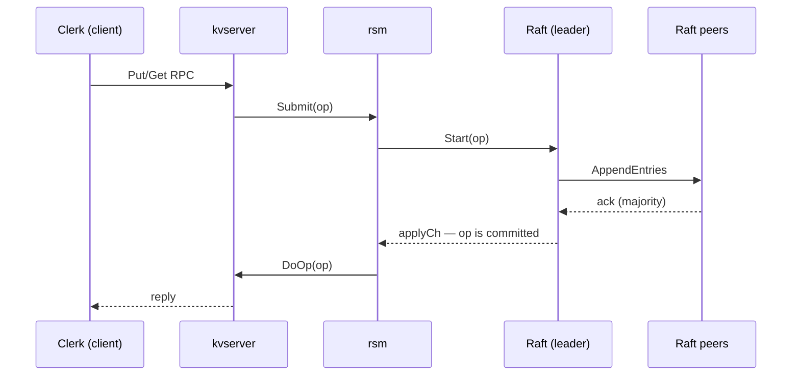
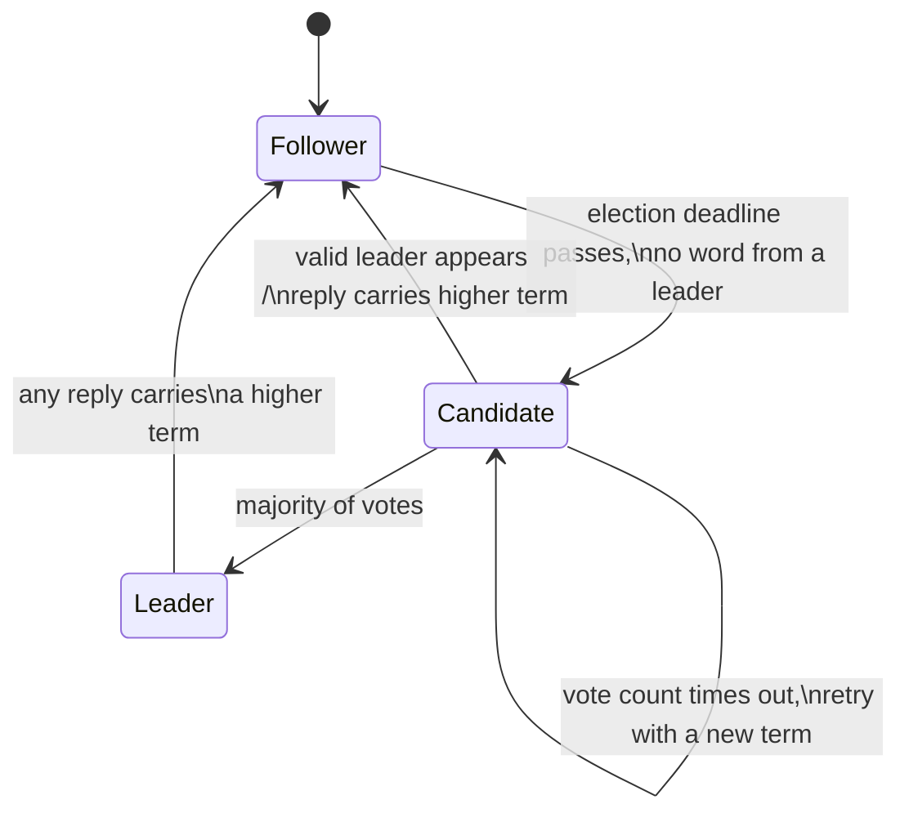

# raft-kv — Building Consensus From the Paper

A fault-tolerant, linearizable key/value store in Go, built on my own
implementation of the Raft consensus algorithm — leader election, log
replication, crash persistence, log-compacting snapshots, a replicated-
state-machine layer, and a versioned KV service on top.

Each chapter below covers one layer of the system: what problem it exists to
solve, what I built, why it's shaped the way it is, and the bugs that taught
me what the paper's sentences actually mean. Read in order, the system
emerges the same way it was built — election first, then logs, then
durability, then everything above.

> Implementation built against MIT 6.5840's lab structure; the
> course-provided test harness, RPC framework, and tests are not included
> per course policy. Every implementation file here is my own work. Because
> the harness packages (`labrpc`, `labgob`, `tester`, `kvtest`) are
> excluded, the repo intentionally does not build standalone — it is meant
> to be read. A small self-contained driver is planned.

---

## Table of contents

- [The system at a glance](#the-system-at-a-glance)
- [Chapter 1 — Leader election: agreeing on who speaks](#chapter-1--leader-election-agreeing-on-who-speaks)
- [Chapter 2 — Log replication: agreeing on what happened](#chapter-2--log-replication-agreeing-on-what-happened)
- [Chapter 3 — Persistence: surviving your own death](#chapter-3--persistence-surviving-your-own-death)
- [Chapter 4 — Snapshots: forgetting safely](#chapter-4--snapshots-forgetting-safely)
- [Chapter 5 — The rsm layer: from consensus to a service](#chapter-5--the-rsm-layer-from-consensus-to-a-service)
- [Chapter 6 — The KV store: linearizability at the edge](#chapter-6--the-kv-store-linearizability-at-the-edge)
- [Chapter 7 — Testing: how the bugs were actually found](#chapter-7--testing-how-the-bugs-were-actually-found)
- [Repo map](#repo-map)

---

## The system at a glance

Five servers, any two of which may be dead, partitioned, or lying about the
past (stale RPCs — the network reorders and duplicates). A client wants
`Put("k","v")` to behave as if there were one perfect server. Everything in
this repo exists to close the gap between those two sentences.

A request flows down through the layers and back up:



Underneath it all, every server runs the same three-role state machine.
Which role a server is in decides what it does with every message it
receives:



---

## Chapter 1 — Leader election: agreeing on who speaks

### The problem

Raft's first move is to make consensus asymmetric: instead of five servers
negotiating every value as equals, they elect one leader and route
everything through it. That converts "agree on a log" into two smaller
problems — agree on *who leads*, then let the leader dictate. This chapter
is the first problem.

The contract sounds small: **at most one leader per term**, a new leader
within a few seconds of the old one dying, and heartbeats capped at ten per
second. What makes it hard is what you *don't* have. There is no shared
clock, no shared memory, and the only channel between servers is an RPC
layer that may delay a message, drop it, or deliver it after the world has
moved on. Every belief a server holds — "I am the leader", "my vote is
cast" — was true when the message that produced it was sent, not
necessarily now. Election is the first place that lesson gets beaten in,
and nearly every bug below is that lesson in a different costume.

One early insight set the shape of all the code that followed. My first
instinct was to put follower behavior in the ticker loop — some place where
the follower "runs". But a follower doesn't run anything; a follower
*reacts*. Its entire behavior lives in the RPC handlers (`RequestVote`,
`AppendEntries`), which the RPC framework invokes whenever a remote peer
calls. The ticker owns exactly one follower decision — "has it been too
long since I heard from anyone?" — and everything else is handlers
mutating shared state under the mutex. Once I saw the design that way, the
Raft struct stopped being an actor and became what it actually is: a lump
of state that many small event-driven pieces read and write under a lock.

### Terms: a clock made of integers

Raft replaces wall-clock time with a monotonically increasing integer, the
**term**. Each term contains at most one election and at most one winner.
Every RPC — request *and* reply — carries the sender's term, and the rule
that keeps the whole cluster's sense of "now" coherent is mechanical:

> If any message arrives carrying a term higher than yours, your term is
> over. Adopt the new term, drop to follower, clear your vote.

I ended up re-learning that rule twice, because it applies in a place I
didn't expect: **replies**. My candidate checked votes but ignored the term
riding on a rejected vote; my leader ignored the term riding on a rejected
heartbeat. The second one produces a genuinely scary failure: an old leader
gets partitioned away, the cluster elects a successor at a higher term, the
partition heals — and the old leader keeps sending heartbeats and believing
itself in charge, because it never *reads* the rejections telling it
otherwise. Two servers behaving as leader at once. Same miss, two places,
one lesson: in an asynchronous network, replies are just more messages, and
every message can carry news that your world is stale. In `raft.go`, the
higher-term check is the first thing every reply handler does, and the
step-down it triggers also resets the election timer — without that reset,
the freshly demoted leader's timer is long expired and it would immediately
campaign against the very leader that just deposed it.

There is a subtle asymmetry in the step-down worth spelling out, because it
decides who is allowed to disturb the cluster. A *higher* term deposes you
no matter how wrong its sender is about everything else — even a candidate
that can never win an election (its log is too far behind) can force the
current leader out just by incrementing its term and asking for votes. The
paper calls these disruptive servers, and they're not a corner case; they
are the default behavior of any server whose election timer misfires. Most
of the timer discipline in this chapter exists to keep servers from
becoming disruptive by accident.

### The timer, and where randomness has to live

A follower becomes a candidate when it hasn't heard from a leader for one
*election timeout*. If every server used the same timeout, all of them
would time out together, split the vote forever, and no one would ever win.
Raft's fix is famously boring — randomize the timeout — and section 5.2 of
the paper is honest about how they got there: they tried ranking
candidates, drowned in edge cases, and fell back to randomness because it
was obvious and analyzable. I picked 400–700ms rather than the paper's
150–300ms because the lab's heartbeat budget forces it: heartbeats are
capped at 10/sec, so beats arrive ~100ms apart, and a timeout has to sit
comfortably above that gap or healthy followers would campaign against a
live leader — while staying far under the lab's five-second recovery
requirement.

What I got wrong initially wasn't the range — it was **where the randomness
lived**. My first design was layered: every server crossed a *fixed* 400ms
threshold, then slept a random 50–300ms, then re-checked and campaigned.
Each piece sounded reasonable, and an AI code review even flagged the
layering as a bug for the wrong reason, which I correctly argued down — the
layered design isn't *incorrect*. But it has a cost I only saw later, with
measurements: in the tester, all five servers boot at the same instant, so
all five cross the fixed threshold on the same tick, and the only thing
separating their elections is the post-threshold sleep. When I finally
instrumented startup (chapter 7 tells that story), the numbers were
damning: in 76% of 120 instrumented boots, two or more servers became
candidates in the same round, because two sleeps had ended within less than
an RPC's travel time of each other. Two real candidates means two
self-votes, means a split round.

The redesign moves the randomness into the deadline itself.
`resetElectionTimer` draws a fresh random 400–700ms deadline on *every*
reset — on hearing a heartbeat, on granting a vote, on stepping down, on
starting an election, and once at boot. Now servers never share a threshold
in the first place; there is nothing left to synchronize on. It also closed
a second hole for free: the old code slept *between* checking the timer and
starting the election, so a heartbeat arriving mid-sleep was ignored and a
pointless election fired anyway. Now the deadline check and the role change
happen under one continuous lock hold — there is no gap for a heartbeat to
sneak into, so the re-check ceremony could be deleted outright.

### Campaigning: fan out, count to majority, never wait for everyone

When the deadline passes, the ticker increments the term, votes for itself,
stamps a fresh random deadline, and fans a `RequestVote` out to every peer
in its own goroutine. Two decisions in that fan-out took me multiple
sessions to get right, and both are really the same question: *what does a
candidate wait for?*

**First attempt: a `sync.WaitGroup`** — launch all the RPCs, wait for all
replies, then count. It deadlocks by design. Raft only needs a majority
precisely because a minority of servers may be dead or unreachable, and a
`Call()` to an unreachable server just doesn't return for a long time.
Waiting for *all* replies makes the candidate's fate hostage to its
slowest, deadest peer — my cluster sat frozen mid-election while new
elections should have been firing. The realization was that the WaitGroup
wasn't a bug in the code so much as a wrong model of the problem: consensus
progress must never depend on the servers that aren't answering.

**Second attempt, the one that stuck: a buffered channel and a race against
the clock.** Each vote goroutine drops a message into a channel; the
candidate sits in a `select`, counting votes as they arrive, against a
300ms timeout:

```go
votes := 1 // self-vote — cast when we became candidate, already in the count
countLoop:
for {
    select {
    case <-ch:                      // a vote arrived
        votes++
        if votes >= (noPeers/2)+1 { won = true; break countLoop }
    case <-timeout:                 // majority unreachable — give up,
        break countLoop             // ticker retries with a fresh term
    }
    // also bail if a real leader's AppendEntries demoted us mid-count
}
```

Majority arrives → leader. Timeout fires → give up, and the *next* tick
starts a fresh election with a new term. A third exit matters just as much:
if a valid leader's heartbeat lands mid-count, the handler has already
demoted us to follower, and the loop checks for that and bails — a
candidate that has seen a real leader has no business counting votes.

That `votes := 1` line carries its own story: I originally started the
counter at zero and fudged the threshold to compensate, and for three peers
the math quietly demanded both other servers vote yes. The paper says a
candidate votes for itself *first* and then solicits — the self-vote is a
real ballot, already cast by the time the RPCs go out. The counter starts
at one because the count is of ballots, not of replies.

**Leftover goroutines were the subtle half of the design.** Vote goroutines
from a finished election don't vanish — their RPCs complete seconds later,
and if they could still touch the channel, votes from a *dead* election
would leak into the count of the next one. Each sender therefore `select`s
between delivering its vote and a `done` channel; when the count loop
exits, `close(done)` broadcasts "this election is over" to every straggler
at once. The broadcast works because of what closing a channel means in Go:
a closed channel is permanently readable, so every goroutine blocked on
`<-done` — and every future one — unblocks immediately. Late votes get
dropped on the floor, which is exactly what stale messages deserve.

One Go-level inversion inside those goroutines is worth recording because
my C++ instincts had it exactly backwards. I wanted to pass the reply
struct by pointer "so the RPC could write back into it" — but a pointer to
the shared outer variable is precisely how every goroutine ends up writing
into the *same* memory: a data race. Passing the struct **by value** gives
each goroutine a private copy on its own stack, and `&res` inside hands the
RPC a pointer to *that* copy. The reply lands fine. Share state under a
lock; give every goroutine its own reply buffer.

While debugging all of this, the errors changed between runs without any
code changing, and that itself was a lesson: with goroutines and randomized
timers, several bugs coexist and which one surfaces first is
non-deterministic. Chasing "the" error is chasing a mirage; the useful move
is cataloging *all* the suspicious behavior before fixing any of it. My
best session of the lab was exactly that — a sweep that found seven
election bugs in one afternoon by refusing to stop at the first.

### The vote itself: one ballot, and only to a worthy candidate

The `RequestVote` handler grants a vote only if all three hold:

1. **The candidate's term isn't behind mine.** A stale candidate is
   rejected and told the current term, so it can update itself.
2. **I haven't already voted for someone else this term.** `votedFor` is
   the one-ballot-per-term rule, and (chapter 3 spoiler) it's the single
   most safety-critical value in the system — a server that forgets its
   vote across a crash can vote twice in the same term, and two leaders can
   win.
3. **The candidate's log is at least as up-to-date as mine** — compare last
   log *term* first, length as the tiebreak. This is the election half of
   the safety argument (§5.4.1): commitment means "a majority holds it", so
   requiring a majority of votes *and* requiring voters to refuse
   candidates behind them guarantees the winner's log contains every
   committed entry — the two majorities must overlap somewhere, and that
   overlap server's vote enforces the check. Elections don't just pick a
   talker; they pick a server that is safe to dictate history. (In this
   file the comparison reads `rf.log[0].Index + len(rf.log) - 1` for "my
   last index" — chapter 4 explains why an entry's index and its slice
   position stop being the same thing once snapshots trim the log.)

And one line that looks decorative but isn't: **granting a vote resets the
follower's election timer.** I found this as bug #6 of the seven-bug sweep
— without it, a follower grants its vote and then, its own deadline having
quietly expired, immediately launches a rival election against the very
candidate it just endorsed.

### The 14% flake: a war story about a timer nobody reset

This one surfaced weeks later, during log replication (3B), and it's my
favorite bug in the project because a single missing line produced a purely
*statistical* symptom — and because the hunt for it went through a plot
twist that deserves its own chapter (it gets one: chapter 7).

3B passed when I ran it once. One run means nothing when the code runs on
random timers, so I ran the whole suite a hundred times: **86 pass, 14
fail**. The failures had structure everywhere I looked. Every one printed
the same error — "one(X) failed to reach agreement". Every one died 3.0–3.3
seconds in, and that number decodes: the tester polls up to ~1s to find a
leader that accepts the command, then waits exactly 2s for every server to
apply it — a 3.1s fingerprint that means *a leader was elected and accepted
the command, and the entry still never committed*. And 11 of the 14 were
the same test — the only five-server test, where startup elections collide
the most. Election churn at boot, not replication.

The mechanism, once I finally saw it: **starting an election resets
nothing.** The election timer's contract is "act only if nothing has
happened for a full timeout" — and starting an election is itself something
happening. A candidate that loses (votes split, someone else won) still has
its ancient pre-election timer, so it is instantly overdue: the very next
ticker pass starts *another* election, one term higher. And per the
disruptive-servers rule above, that higher term forces the freshly elected
leader to step down without the loser winning a single vote. Meanwhile the
deposed leader is holding the test's command, uncommitted — and here the
bug interlocks with a *correct* safety rule in a way I found genuinely
beautiful: a new leader may never commit a previous term's entry by
counting replicas (§5.4.2, chapter 2 explains why). So even when the
original leader wins re-election, the entry sits legally uncommittable
until a new command arrives — and the test never sends one. My safety rule
was exactly what kept the entry stuck. Safety decides what *may* commit;
liveness decides whether anything *does*.

The fix is one call — `resetElectionTimer()` the moment candidacy begins —
which gives every losing candidate a full, fresh, randomized timeout during
which the winner's ~100ms heartbeats reach it and settle it down. I pushed
back on this fix before accepting it: surely the loser hears the new
leader's heartbeat and goes quiet anyway? Wrong three ways — the ticker's
election gate never checks role, only elapsed time; the heartbeat has to
*win a race* against the loser's next 10ms tick; and once the loser bumps
its term, the heartbeat gets rejected as stale and the rejection itself
carries the term that deposes the leader. Arguing against the fix and
losing the argument is what actually made me understand it.

Postscript, and a preview of chapter 7: after committing this fix, the
gauntlet *still* read 89/100 the next morning. The fix was correct — it
just wasn't in the binary my tests were running. And after that got
untangled, the residual ~2.5% traced to the boot-collision problem that
finally motivated the randomized-deadline redesign above. Three overlapping
failure sources — a real bug, a stale binary, and a design cost — told
apart only because each had a measurable *rate*.

### What election leaves unsolved

At the end of this chapter the cluster can reliably agree on who speaks —
elect one leader, survive its death, converge again after partitions heal.
But the leader has nothing to say yet: there is no log, no commitment, no
state machine. And the up-to-date check in rule 3 above is quietly waiting
for logs to exist so it has something to compare. Chapter 2 gives the
leader its actual job.

---

## Chapter 2 — Log replication: agreeing on what happened

### The problem

A leader exists; now it has to do the only thing leaders are for: impose
one ordered history of operations on the whole cluster. The instrument is
the **log** — every server keeps one, and the goal is that all of them end
up identical, in order, forever, while the network drops, delays,
duplicates, and reorders everything in flight and servers crash at the
worst moments.

The paper's tool for reasoning about this is the **Log Matching Property**:
if two logs have an entry with the same index and the same term, then the
entries store the same command *and* the logs are identical everywhere
before that point. Nothing in the code "implements" this property directly
— it's an invariant that the AppendEntries consistency check inductively
maintains, and half this chapter is about the bugs I wrote by accidentally
breaking it.

The flow, end to end: a service calls `Start(command)` on the leader. The
leader appends the entry to its own log and returns immediately — `Start`
is a promise to *try*, not a receipt. In the background the leader
replicates the entry to followers via AppendEntries; when a majority holds
it, the entry is **committed**; every server then feeds committed entries,
in order, up its `applyCh` to whatever state machine sits above. My first
misreading was to treat `Start` as something my code called internally —
grep showed me the truth (the service above calls it; the command arrives
from outside), and the misreading was useful: it forced me to see the log's
boundary interfaces — `Start` in, `applyCh` out — as the *only* doors, with
everything between them Raft's private business.

Two bookkeeping arrays drive replication, both leader-only and both
rebuilt on every election win: `nextIndex[p]` — the optimistic guess of
where to send follower *p* next — and `matchIndex[p]` — the pessimistic
proof of what *p* has confirmed. I spent a while convinced `nextIndex` was
redundant ("matchIndex plus one, surely") and I was more right than the
paper let on: matchIndex alone would be *correct* — it drives commitment,
which is the part that must be true. nextIndex exists purely so probing for
where a diverged follower's log matches doesn't have to restart from the
proven floor every time. One array is truth, the other is speed.

A design note that saved me a class of bugs: **heartbeats are not a
mechanism**. An AppendEntries with no entries *is* the heartbeat. There's
one timer, one send path, one handler; when a follower is caught up,
`log[nextIndex:]` is empty and the RPC happens to carry nothing. I
initially assumed the reply's `Success` field meant "heartbeat received" —
it doesn't; it answers exactly one question, *does your log match mine at
PrevLogIndex?* — and getting that straight collapsed heartbeats from a
separate feature into a circumstance. Relatedly, the AppendEntries args
must be built **per follower, inside the peer loop** — each follower has
its own nextIndex, so each gets its own PrevLogIndex/PrevLogTerm/Entries.
Moving that construction from outside the loop to inside it was the moment
replication started actually working; one shared args struct can only ever
describe one follower's needs.

### The consistency check, and the truncation that ate a committed entry

Every AppendEntries carries `PrevLogIndex` and `PrevLogTerm` — "my log and
yours agree through here, right?" The follower checks its own entry at that
index. Match → accept the new entries. Mismatch → reject, and the leader
backs up and probes earlier. This check is what makes Log Matching
inductive: entries are only ever appended behind a verified agreement
point.

My first accept path did the obvious thing:

```go
rf.log = append(rf.log[:args.PrevLogIndex+1], args.Entries...)
```

Truncate, then take the leader's entries. It looks harmless — the entries
come from the leader, and the leader is the truth. The flaw is an
assumption I didn't know I was making: that RPCs arrive in the order they
were sent. They don't, and the killer interleaving needs only *one* leader
and *one* follower, no elections at all. The leader fires two AppendEntries
at the same follower — tick one carries entries through index 8, tick two
through index 10 (in-flight concurrently, chapter 1's fire-and-forget
goroutines). The network delivers the *longer* one first. The follower
appends through 10; the leader sees the ack, commits, applies. Then the
stale shorter RPC arrives, passes the consistency check perfectly (it *is*
a valid prefix), and the truncate silently deletes committed entries 9 and
10. A committed entry must never be lost, and my handler was deleting them
in the normal case, no failures required.

I argued with this bug before fixing it — my instinct said truncation
preserves the leader's completeness, so what's the harm? The harm is that
"the leader's log" and "what this RPC describes" are different things: the
RPC is a *snapshot of the past*, and acting on it as if it were the present
is exactly the stale-actor mistake this whole system exists to prevent.
Figure 2's actual rule is surgical: delete **only on conflict** — same
index, different term. So the fix walks the entries one slot at a time,
three cases each:

- **Slot doesn't exist** → my log ends here; append the rest, stop.
- **Same index, same term** → I already have it (Log Matching says it's
  identical); touch *nothing*, keep walking. A stale shorter RPC now walks
  through in silence — a no-op, which is what stale information deserves.
- **Same index, different term** → a real conflict; everything from here on
  is a dead branch. Truncate here, take the leader's entries, stop.

Deletion still exists — it must, dead branches are real — but it only ever
happens *behind a proven term conflict*, never as a side effect of message
timing.

My first version of the walk itself had four bugs, and I keep the list as a
warning about off-by-one thinking: I started the walk *at* PrevLogIndex
instead of one past it (comparing against the anchor I'd already verified);
I bounded the loop by my log's length instead of the entries' length
(panics one way, silently appends nothing the other); on conflict I
overwrote a single slot and kept walking, leaving dead-branch entries
stranded *after* new-term entries — Figure 2 says delete the conflict *and
everything after it*; and my "missing entry" branch was the exact negation
of a condition I had already `continue`d past, so it could never run.
Walk-style code earns its correctness one boundary condition at a time.

The walk forced a companion fix I would never have found alone. The
follower advances its commitIndex from the leader's `LeaderCommit` — but to
*what*? The old code clamped to my log's length. After the walk, a stale
RPC no longer trims my log, so my log can hold a longer tail that *this*
RPC said nothing about — and committing into it on this RPC's word would be
committing entries the leader never vouched for. The clamp became
`min(LeaderCommit, PrevLogIndex + len(Entries))`: commit only what this
message actually testified to.

### Replies from the past: the term guard and the max clamp

The reply side of AppendEntries taught me the deepest rule in the chapter:
**a reply is only valid for the term it was requested in.**

My handler had one safety check — if the reply carries a higher term, step
down. I believed that was sufficient; the greater term always wins, so any
term trouble gets caught. But that check only guards against replies from
my *future*. It does nothing about replies from my own *past* — and those
have a lower term, so they sail right through. The timeline that made it
click: I'm leader in term 3, I send an AppendEntries to P, the network
delays it. I get partitioned, lose leadership, rejoin, win again — leader
in term 5, nextIndex/matchIndex freshly re-initialized. Now the term-3
reply finally lands. Is its term greater than mine? No. So it falls
through and edits my fresh term-5 bookkeeping using an answer to a
question a *different leadership incarnation* asked. "Am I still the
leader" was never the right question; the right question is "am I still
the *same* leader that sent this exact request" — and only the term can
answer it, because I stamped the request with the term I sent it in:

```go
if rf.role != Leader || rf.currentTerm != req.LeaderTerm { return }
```

Re-initialization can't fix this — reinit happens the moment I win, and the
stale reply arrives *after*, clobbering the fresh state. The bug is
fundamentally about epochs, so the fix has to encode the epoch.

Its sibling: **matchIndex must never move backward.** Replies arrive out of
order even within one term — tick one's request (covering through index 5)
and tick two's (through index 8) are in flight together, and if the second
reply lands first, the first would drag matchIndex back from 8 to 5, and
the commit scan would stall believing the follower lost entries it holds.
`matchIndex[p] = max(matchIndex[p], req.PrevLogIndex + len(req.Entries))`
makes the update immune to reply order. The pleasing detail: the `max`
neutralizes stale *successes* all by itself, so the term guard is really
there for stale *failures* — which would otherwise decrement nextIndex
spuriously. Belt for one direction, suspenders for the other.

Neither bug shows up on a reliable network — replies come back promptly and
in order, and everything works. They only bite in the unreliable and
partition tests. That's the recurring shape of this lab: the happy path
teaches nothing; every real lesson arrives with a reordered packet.

And one panic rounded out the set: on a failed reply my code ran
`nextIndex[p] -= 1` unconditionally. Two rejects from the same
behind-follower in flight at once — both built when nextIndex was 2 — and
the decrements stack: 2 → 1 → 0, next round builds `PrevLogIndex = -1`,
and indexing the log at -1 kills the ticker goroutine, which stops
heartbeats, which wedges the whole cluster. I argued against this one too
("the walk-down self-stops at 1!") — true for sequential replies, false
the moment replies overlap. Concurrency doesn't add new logic errors; it
interleaves old correct logic into new wrong orders. The immediate fix was
a floor (never decrement below 1); the real fix — jumping whole terms per
reject instead of stepping — comes with fast backup in chapter 3.

### Commitment: counting only your own term

A leader commits entry N when a majority's matchIndex reaches N — but with
one restriction that looks paranoid and is load-bearing: **only entries
from the leader's current term are committed by counting replicas.** Older
entries commit indirectly, dragged over the line by Log Matching when a
current-term entry above them commits. The paper's Figure 8 constructs the
disaster that this rule prevents: an old-term entry reaches a majority,
gets counted committed, and is *still* overwritten by a later leader that
won without it — "replicated on a majority" is only durable if the term
also proves the replication happened under the current regime.

I met this rule twice. Once as the accomplice in chapter 1's 14% flake —
it's what kept the orphaned entry legally uncommittable while the test's
clock ran out. And once conceptually: real systems sidestep the stuck-entry
problem by having a fresh leader immediately commit a no-op in its own
term, dragging old entries over the line; the lab's tests assume you don't.
Both entries in the same ledger: safety rules are allowed to cost you
liveness, and the cost is paid in exactly the situations tests love to
manufacture.

The commit scan itself runs in two places — the ticker (each round) and,
after the speed work in chapter 6, the AppendEntries reply handler at the
moment a majority ack actually arrives. Same scan, moved to where the
information enters the system.

### Terms are not a clock: the mixed-epoch panic

The last bug of 3B was the one that changed how I think about distributed
state generally. The leader's tick photographs `role` and `term` under one
lock at the top, unlocks, then re-locks per peer to build each
AppendEntries. I thought of that as one continuous action. It isn't. Every
unlock is a door, and other goroutines — reply handlers, my own
AppendEntries handler — walk through it and change role, currentTerm, even
`rf.log`, while my tick stands in the hallway holding an old photograph.
`term := rf.currentTerm` is a *copy*; when another goroutine moves the
world to term 6, my local still says 5, and nothing will ever refresh it
except me re-locking and looking.

My mental model said that couldn't matter: "when the cluster reaches term
7, term 5 is over." Both halves of that are false. A term bump is one line
— writing an int cancels nothing: no goroutine is interrupted, no in-flight
RPC recalled, no local variable updated; all the term-5 machinery keeps
executing until each piece individually hits a check. And across servers
it's worse — a server learns of a new term only when a *message* carrying
it arrives, so during a partition, term 5 is genuinely still the present on
one side while term 6 gets elected on the other. "The cluster is at term 7"
is a sentence no single server can ever verify.

The concrete disaster, five servers, all moves legal: S1 leads term 5 with
log through index 9; S2 has acked everything, so nextIndex[S2] = 10;
S3/S4/S5 hold only through index 4 — entries 5–9 live on two of five
servers, uncommitted. Partition {S1,S2} away, S3 wins term 6 (S4/S5's logs
match its own), takes a client command. The partition heals *mid-tick* on
S1: its tick has photographed (Leader, 5) and served three peers when S3's
term-6 AppendEntries lands in the gap — S1's handler steps down and the
entry walk truncates the log to length 6. The tick resumes for peer S2,
photograph still saying (Leader, 5): `prevIndex := nextIndex[S2] - 1` = 9,
`rf.log[9]` — index out of range, panic. Each half of that expression was
valid in its own world; the expression mixed two epochs. The out-of-range
panic is just the loudest symptom of the real bug: **mixed-epoch state**.

The guard, inside the per-peer lock, before building args:

```go
if rf.role != Leader || rf.currentTerm != term {
    rf.mu.Unlock()
    break
}
```

Honesty about the two conditions: in today's code the role check alone
would suffice, because becoming leader only happens inside the ticker
goroutine itself, so "deposed then re-elected mid-loop" can't interleave.
But that's correctness by coincidence of goroutine layout — the moment
sending moves off the ticker (per-peer replication goroutines are on my
list), leader-again-at-a-new-term becomes a real interleaving and the role
check silently stops being enough. The term check states the actual
invariant: *act only if it is still the term this tick was started for*.

And the window that can't be closed: guard passes, args built, and *then*
we're deposed — the stale term-5 RPC goes out anyway. That's fine, and
understanding why it's fine is the whole point of Raft's defensive style.
You cannot atomically check leadership and deliver a message over a network
— deposition can happen while the packet is in flight. The args were built
as one consistent snapshot under one lock hold, so the message is
internally true — "the term-5 leader sends this," and it did. Receivers
judge it by its term field; anyone at 6+ rejects it; a deposed sender's
reply handler drops even a successful reply via the term guard. A late send
is indistinguishable from network delay, which Raft already survives. The
sentence I keep: **you can never stop stale actors from acting — you can
only make every action carry its epoch, and make every state-toucher verify
the epoch before applying it.**

### The applier, and a promise about what can be lost

The final piece is the applier goroutine (started in `Make`): whenever
`commitIndex > lastApplied`, it steps forward one entry and sends it up
`applyCh`. The channel is unbuffered, so a send parks until the service
receives — which is correct (the service controls its own pace) and, much
later, becomes a deadlock ingredient snapshots have to respect (chapter 4).

Worth stating precisely what all this machinery does and doesn't promise,
because the KV layers above are built on the exact boundary: **Raft
guarantees no committed entry is ever lost. It does not guarantee your
attempt survives.** An entry accepted by `Start` on a leader that then
crashes can simply vanish — the client learns nothing except a timeout, and
"timeout" includes "your entry was silently erased by the next leader."
If you saw Success, it's permanent; if you saw silence, anything is
possible. Chapter 6's `ErrMaybe` is that sentence turned into an API.

---

## Chapter 3 — Persistence: surviving your own death

### The problem

The tester now crashes servers and restarts them. A crashed server loses
everything in memory; when it comes back, it must remember enough that the
*cluster's* promises survive its personal amnesia. Figure 2's answer is
spare: exactly three things go to stable storage — `currentTerm`,
`votedFor`, and the log. Each has its own catastrophe. Forget `votedFor`
and a rebooted server can vote a second time in the same term — two
"majorities", two leaders. Forget `currentTerm` and it reboots at term 0,
trusting leaders that were deposed long ago. Forget the log and committed
entries — the actual data — are gone. Nothing else is saved: commitIndex,
lastApplied, nextIndex, matchIndex, and the role are all reconstructed from
normal traffic, so persisting them would be wasted writes (snapshots later
add one asterisk to this — chapter 4).

The code is two small functions — `persist()` encodes the triple,
`readPersist()` decodes it at boot. Writing them was not the work. The work
was deciding *when* to call `persist()`, and the answer compresses into one
rule I now consider the chapter's entire content:

> **Nobody outside this server may observe a state change that is not yet
> on disk.**

### Publication, not protection

Deriving the rule took walking both crash orders. Suppose a handler mutates
the log and crashes *before* persisting. The change was only in memory;
memory is gone; disk holds the pre-RPC state; the server reboots into it.
But the handler died before returning, so the reply never went out — to the
leader this is exactly a dropped RPC, which Raft already handles by
resending. A crash before persist retroactively turns the whole RPC into
"never arrived." Nothing promised, nothing broken.

Now the reverse: grant a vote, send the reply, *then* crash before
persisting. The reply escaped — the candidate is counting my vote. My disk
never heard about it, so I reboot with `votedFor` empty, and when the next
candidate asks, I vote again. Same term, two votes, potentially two
leaders. The reply is a promise, and persisting before replying is what
makes promises survive crashes.

So `persist()` is not protection from the computation — it's *publication*
of the result, and it can only run after the result exists. That's also why
"persist at the top of the function, defensively" is exactly backwards: it
would burn a disk write re-saving what the last mutator already saved,
while the *new* values — the vote about to be granted, the entries about to
be appended — never reach disk at all. The vote-twice bug, reinvented via
caution.

Two refinements sharpen the rule. First, the observation can escape through
more doors than the reply: the moment the mutex is released, other
goroutines on my *own* server can read the new term and build RPCs from it
— state not yet on disk, leaking sideways. So the real deadline is *before
the unlock*, not before the reply. Second, torn state on disk is impossible
by construction, and it's worth knowing why rather than hoping: the handler
holds the mutex from before it reads anything until after `persist()`
returns, so every other goroutine is parked at the lock while the encoder
runs — and the handler's own code runs top to bottom, so by the persist
line, every branch above has finished. Disk only ever receives snapshots
taken at rest points. It's a transaction: lock, mutate, commit, release.

I seriously considered `defer rf.persist()` — defers fire on every return
path, making "forgot to persist an exit" structurally impossible. Two traps
killed it. The sneaky one is ordering: defers run LIFO, so `defer
rf.persist()` written *after* `defer rf.mu.Unlock()` runs *before* the
unlock (correct), while the visually identical opposite order persists
*after* releasing the lock — another goroutine can be halfway through
mutating the log while the encoder walks it, the torn-snapshot bug snuck
back in through two lines that look interchangeable. Correct code that
reads backwards and breaks when a future cleanup "fixes" the order is a
liability. The honest one is cost: defer fires on the do-nothing paths too,
and each `persist()` encodes the *entire log*; heartbeats hit the
AppendEntries handler ten times a second per follower, and the
reject-stale-leader path mutates nothing. Explicit calls after the last
change, before the unlock, let the no-op paths return free.

### The audit: one hidden bug, several wasted writes

With the rule in hand I audited every mutation site of the three values.
The rule is mechanical; one path still slipped through it. `RequestVote`
opens by adopting a higher term if the candidate carries one —
`currentTerm` up, `votedFor` cleared: two persistent mutations. Then it
goes on to judge the vote, and if the candidate's log fails the up-to-date
check, it takes an early return to reject. My `persist()` sat on the grant
path. On the reject path, the reply went out carrying my *new* term while
disk still held the old one — crash after replying, and I reboot into a
term I already told the world I had left. The fix puts a `persist()` inside
the term-adoption block itself, so the mutation is published no matter
which exit the function takes afterward. The general lesson: **an early
return between a mutation and the persist below it silently un-covers the
mutation.** Every exit path after a change must cross a persist — not just
the happy one.

The audit's other finding was the opposite disease: persists where nothing
persistent had changed. The worst sat at the top of the ticker loop —
every 10ms, every server, a full encode of the entire log, protecting
nothing, since that block touches no persistent value. More in the args
builder, the commit scan (commitIndex is volatile — rebuilt from traffic,
never on disk), the vote loop. None were safety bugs — persisting unchanged
state can't break anything — but each was pure heat. All deleted.
`persist()` now fires exactly where Figure 2 state actually mutates, and
nowhere else.

### Fast backup: skipping a term per rejection instead of an entry

3C's tests also manufacture a scenario that turns a slow protocol corner
into a failing one. When a follower rejects the consistency check, the
baseline protocol steps `nextIndex` back by one and reprobes next round:
one rejection, one network round-trip, one entry of progress. The tests
build followers hundreds of entries adrift (a partitioned leader stuffing
its log solo), and hundreds of round-trips don't fit the clock. The paper
describes the remedy in §5.3 and then shrugs — "we doubt this optimization
is necessary, since failures happen infrequently" — and the lab
manufactures exactly the situation the paper doubts, so here it is
necessary.

The follower's rejection stops saying just "no" and starts describing what
it actually holds at the probe point, in three fields:

- **XTerm** — the term of the follower's own entry at PrevLogIndex (the
  term that caused the mismatch), or −1 if it has no entry there at all.
- **XIndex** — the *first* index in the follower's log holding XTerm; the
  follower walks backward while the term stays the same, so
  [XIndex, PrevLogIndex] is one unbroken run of a single term.
- **XLen** — the follower's log length, for the too-short case.

Two rejection shapes — "wrong term there" and "nothing there" — and the
leader answers with one jump, chosen by three rules read top to bottom:

1. **XTerm = −1** → the follower's log ends before the probe point; jump
   `nextIndex` to XLen. No slot past the follower's end can be the match
   point, because those slots don't exist.
2. **I have no entry of term XTerm anywhere** → the follower's whole run of
   that term is a dead branch I never shared; no slot in
   [XIndex, PrevLogIndex] can match. Jump to XIndex, skipping the entire
   run in one move.
3. **I do have XTerm entries** → at my *last* entry of that term, both logs
   hold the same term at the same index — Log Matching makes that a
   verified match, and everything before it identical. Jump to one past it.

The scan of my own log for XTerm is a memory walk on the leader — free next
to a network round-trip. What the optimization eliminates is round-trips:
one per divergent *term* instead of one per divergent entry.

The subtlety I got wrong at first: I assumed that after a jump, the logs
below the new nextIndex were verified equal. They are not. **The jump is a
guess** — a safe one, guaranteed only never to overshoot past the truth,
because every skipped slot is provably a non-match. Whether the new probe
point actually matches is checked the way it always was: the next
AppendEntries carries PrevLogIndex/PrevLogTerm and the follower judges. Two
divergent terms means two rejections, two jumps. Certainty arrives only
when a probe *succeeds* — at that moment Log Matching retroactively
guarantees the whole prefix. And the guess's failure modes are asymmetric
in exactly the right way: backing up too far is harmless (the re-sent
entries hit the walk's "same index, same term, touch nothing" case), and
not backing up far enough just earns another rejection. The safety never
lived in the jump; it lives in the probe check and the walk. The jump is
merely a better guess than "one step back."

---

## Chapter 4 — Snapshots: forgetting safely

### The problem

The log grows forever. Every Put ever made, replayed at every reboot,
stored on every disk — for a state machine whose *current state* might be
one small map. The realization that unlocks the design: the log is only a
*recipe* for the state. If the log says `put(x,1), put(x,2), put(x,3)`, all
anyone needs is `{x:3}`. Once entries are applied, they're dead weight. A
snapshot is a photo of the dish at step 1000 — keep the photo plus the
recipe from step 1001 on, burn the rest. Same information, bounded size,
faster restarts.

Two facts frame everything: each server snapshots *independently* (no
cluster-wide coordination — the snapshot covers only committed, applied
entries, which are identical everywhere by construction), and the *service*
decides when, because only the service knows what the bytes mean.

### My first version was backwards

My first `Snapshot(index, blob)` built an `ApplyMsg` and sent it up
`applyCh`. The reasoning felt airtight — "snapshots get applied, applying
means the apply channel." It compiles; it's nonsense. The service *created*
the blob: it serialized its own state machine into bytes and is handing the
box *down* to Raft, saying "I have everything through `index` in here — you
may burn your log through `index`." Sending an ApplyMsg back up re-delivers
what the service already has. It made the box; it does not need the box
back.

Getting the two directions straight organized the whole lab for me:

- **`Snapshot(index, blob)` — service → Raft, down only.** "Here's the
  photo; trim your log." The apply channel is not involved at all.
- **`InstallSnapshot` — leader → lagging follower → that follower's
  service.** The *only* place a snapshot travels up an applyCh, because
  that service genuinely is behind and needs the box's contents.

The broken version had three more bugs worth their tuition: it set both
`CommandValid` and `SnapshotValid` (the contract is exactly one), it
stamped the snapshot with `currentTerm` instead of the term of the entry
*at* the index (an old entry keeps its old term), and it trimmed with
`rf.log = rf.log[index:]` — which reslices but keeps the old backing array
alive, so the memory the whole feature exists to free never gets freed. The
fix copies into a fresh slice so the garbage collector can actually take
the history.

### The sentinel: making the log carry its own offset

After burning entries 1–999, global entry #1005 no longer lives at slice
position 1005 — it lives at position 5. But the *protocol* still speaks
global indices everywhere: PrevLogIndex, commitIndex, nextIndex,
matchIndex, the entry's own place in history. Peers neither know nor care
what I trimmed locally. So the whole file has to become bilingual, and the
dictionary is one subtraction:

```
slice position = global index − offset
```

My design makes the log itself store the offset. The entry *at* the
snapshot point stays in the trimmed log as slot 0 — a **sentinel** with its
`Command` nulled (the blob owns the data now) but its `Index` and `Term`
intact. `offset` is simply `rf.log[0].Index` — the global name of slot 0.
Concretely: log holds globals 3–7 after snapshotting at 3; want global 5?
It sits 5−3 = 2 slots past the sentinel. Snapshot again at 6 and the
sentinel becomes 6 — self-updating, no separate variable to keep honest.

The design pays for itself three times over. The dummy `{Term:0, Index:0}`
entry I'd had since 3B turns out to *be* the degenerate sentinel — a fresh
server is just a server that snapshotted at index 0, and the arithmetic is
identical. The paper's two extra persistent values, lastIncludedIndex and
lastIncludedTerm, ride to disk for free inside the log (the sentinel *is*
them), so persistence code doesn't change shape. And after an
InstallSnapshot wipes a follower's log, the fresh sentinel carries exactly
the index and term the next AppendEntries consistency check will probe —
the check works on a post-surgery log with no special cases.

The lab's hint prescribed an order of operations that I now recognize as a
general engineering move: do the index sweep *first*, with offset pinned at
0 — a refactor with provably zero behavior change — and rerun 3B/3C. They
pass → the sweep introduced no bugs. *Then* implement trimming. It
separates "index arithmetic bugs" from "snapshot logic bugs" so a failing
test can only mean one thing. The sweep itself walked every `rf.log[i]` and
`len(rf.log)` in the file asking one question — is this number a global
index or a slice position? — with the protocol always speaking global and
the slice always speaking positions. The nastiest sites weren't the ones
that panic (the ticker reaching for slot 10 of a 2-slot log announces
itself); they were the applier's reads, which after a trim would fetch the
*wrong slot without panicking* and apply the wrong command silently.

Two places needed new logic, not just translation. Follower: if
`PrevLogIndex < offset`, the leader is talking about entries I burned —
but everything ≤ offset is committed, and committed means it matches the
leader *by definition*, so I chop the overlapping prefix off the incoming
entries and slide the probe point up to the sentinel (if the whole RPC
falls inside my snapshot: plain success, it all matched). Leader: if
`nextIndex[p] − 1 < offset`, I literally cannot build the AppendEntries —
the term I'd need for PrevLogTerm was burned. That case stops being
arithmetic and becomes a different RPC entirely.

### Snapshots meet persistence: the nil bomb and the reboot panic

Half of 3D turned out to be a persistence problem wearing a different hat,
and it detonated a line I'd been writing since 3C without reading it.
`persister.Save()` takes two arguments — state and snapshot — and I'd been
passing `Save(raftstate, nil)`. Save doesn't mean "update the first slot";
it means "**here is the complete new contents of the disk**" — both slots,
every call. The moment `Snapshot()` stored a real blob, every existing
`persist()` call in the file became a bomb: the next heartbeat arrives, the
handler dutifully persists at the end like chapter 3 says it must, and
`Save(raftstate, nil)` wipes the only copy of a thousand burned entries —
my own persistence discipline, erasing history fifty milliseconds after it
became irreplaceable. The fix is one line — `persist()` now passes
`rf.persister.ReadSnapshot()` through — but the lesson generalizes: when a
save API rewrites the whole state, every caller owns every field, including
the ones it never thinks about.

Why must the blob be on disk at all? Chapter 3's rule, unchanged: nobody
may observe a change that isn't on disk. Before 3D, the disk's log was
complete history. `Snapshot()` deliberately destroys that property — after
the trim, entries 1–1000 exist *nowhere* except the blob. The blob isn't a
cache; it's load-bearing history, as irreplaceable as the log. Which is why
`Snapshot()` and `InstallSnapshot` write state and blob in **one** `Save()`
call: a crash between "trimmed the log" and "saved the blob" leaves a disk
whose history starts at entry 1001 with no proof of what came before.

And one confident sentence from chapter 3 broke: "volatile state is rebuilt
from normal traffic." Still true — but its *starting point* moved. My
`Make()` initialized commitIndex and lastApplied to 0; reboot a server that
snapshotted at 1000 and the applier counts up from zero, computes slice
position 1 − 1000, and dies. Even if it didn't die, entries 1–999 can never
be re-applied as commands — they aren't commands anymore; they're inside
the blob, and the *service* restores itself from the blob at boot. So after
`readPersist`, boot sets `commitIndex = lastApplied = rf.log[0].Index`:
everything through the sentinel is already committed, already applied,
already inside the box. On a fresh server the sentinel is 0 and the line
changes nothing — the degenerate case again.

### InstallSnapshot: when the photo has to travel

The leader-side clamp above hides a livelock. A follower sleeps through a
partition, wakes needing entry 500 — and the leader burned 500 into its
snapshot. It cannot build the AppendEntries; with only a clamp it probes
from the sentinel, the follower rejects (its log is too short to match),
nextIndex bounces, forever. If you can't send the recipe steps, send the
photo: the `InstallSnapshot` RPC ships the leader's entire blob to the
follower (the lab sends it whole — no chunking, so the paper's
offset/done fields ride along unused).

The follower handler is six moves, each with a reason:

1. **The term dance**, same shape as every RPC: refuse a stale leader (a
   dead regime must not overwrite my state); adopt a higher term; either
   live case → become follower and **reset the election timer**, because
   the blob is proof a live leader exists and campaigning against it would
   be self-sabotage.
2. **The staleness guard**: if `LastIncludedIndex ≤ commitIndex`, ignore.
   The network reorders; an old duplicate InstallSnapshot arriving after
   I've moved past that point would drag me *backward*, discarding newer
   committed state. Same instinct as matchIndex-never-regresses.
3. **Log surgery, two cases.** If my log has an entry at LastIncludedIndex
   with the matching term, keep the tail after it — those entries are still
   valid, possibly ones the leader is about to re-send; same
   skip-don't-truncate philosophy as the chapter 2 walk. Otherwise — too
   short, or wrong term (I'm on a dead branch) — the whole log dies,
   replaced by a single fresh sentinel `{Index: LastIncludedIndex, Term:
   LastIncludedTerm}`, which is precisely what the next consistency check
   needs.
4. **Counters jump**: `commitIndex = lastApplied = LastIncludedIndex` —
   the same promise as the reboot path, since the service is about to
   receive this blob.
5. **Persist state and blob together** — the crash argument, again.
6. **Hand the blob up to the service** — which had a design decision in it.

The decision: the handler must send an ApplyMsg up `applyCh`, but `applyCh`
exists only as an argument to `Make()` — my applier sees it as a closure;
an RPC handler can't, and the framework fixes the handler's signature.
Option one stores the channel on the struct. I chose option two: the
handler leaves the blob in the struct as a *note* — `pendingSnapshot` plus
its index and term — and the applier, which checks the note first thing
each loop, forwards it and clears it. Costs three fields; buys the
invariant that **every applyCh send happens in exactly one goroutine**, so
snapshots and commands can never interleave from two places, and ordering
stays trivially provable. The applier delivers a pending snapshot *before*
any queued commands — the snapshot replaces everything the service had, so
commands sent first would be wasted work — and it sends **outside the
lock**: the send blocks until the service receives (unbuffered channel),
and the service's applier thread sometimes calls back down into
`rf.Snapshot()`, which takes `rf.mu`. Hold the lock across the send and the
two threads wait on each other forever. My broken day-one instinct — "the
handler should push to applyCh" — was pointing at this deadlock all along;
it was right that the send is delicate, just wrong about whose job it was.

The leader side lives in the ticker where args are built: `nextIndex[p] − 1
< offset` → this follower gets the photo this tick instead of entries
(never both — `continue`), fired in a goroutine mirroring the
AppendEntries one. The reply handling is the same three moves as every
reply in this system by now — higher term: step down; stale reply (role or
term moved on): drop; success: `matchIndex[p] =
max(matchIndex[p], LastIncludedIndex)`, nextIndex one past it — so the very
next tick resumes ordinary AppendEntries from right after the snapshot.
The three-move ritual being identical across AppendEntries, RequestVote,
and InstallSnapshot is not laziness; it's the chapter 2 lesson holding
everywhere: every reply is a message from the past until proven current.

---

## Chapter 5 — The rsm layer: from consensus to a service

### The problem

Raft, as built so far, has a strange interface: you push a command in at
one end (`Start`), and *eventually* — maybe — it falls out the other end
(`applyCh`) on every server, in order. What a service wants is a function
call: *submit this operation, block until it has truly executed, give me
its result*. The rsm (replicated state machine) layer converts one into
the other, and it's deliberately generic — it replicates *any* state
machine that implements `DoOp(any) any`, without knowing whether it's
replicating a toy counter (the 4A tests) or a key/value database (chapter
6). Not one line of rsm changes between the two; the replication machinery
never needs to know what it replicates.

Getting the shape right took a day of wrong turns, and the wrong turns were
each a wrong belief about where data flows:

- **I pushed ops into applyCh myself.** Backwards — applyCh is Raft's
  private *exit* pipe. Requests enter through `Start`; committed results
  exit through applyCh. One-way pipeline.
- **I fed applyCh back into Submit.** A goroutine that reads a committed op
  and re-submits it creates an infinite loop — one client request becomes
  endless log entries. The committed message is the *end* of the pipeline,
  not new input.
- **My follower path applied ops directly before returning
  ErrWrongLeader.** That destroys the entire point: an op may only touch
  the state machine after it commits, in log order, identically everywhere.
  A follower applying an op that never went through the log has a state
  machine that agrees with nobody.

### The reader goroutine: one, forever, on every server

The correct shape has exactly one goroutine, started in `MakeRSM`, alive
for the server's whole life:

```go
go func() {
    for {
        msg := <-rsm.applyCh
        op := msg.Command.(Op)
        res := rsm.sm.DoOp(op.Req)
        // ...wake the Submit waiting at msg.CommandIndex, if any...
    }
}()
```

Each word of "one, forever, on every server" is load-bearing. *One*: ops
must apply in log order; a goroutine per message would race and apply in
whatever order the scheduler fancies. *Forever*: my Raft's send on applyCh
blocks until received (unbuffered), so a reader that ever stops reading
freezes Raft itself mid-send — the channel must never go deaf. *On every
server*: I kept hunting for the code where "I" apply the op to the other
servers, and even started writing a loop over the server list. No such
place exists. Replication is Raft's job — chapter 2's AppendEntries.
Each server's own Raft delivers the committed op locally, and each server's
own reader applies it locally. "Apply on every server" is all of us running
identical code, not one of us commanding the rest.

### The waiter map: how Submit sleeps and gets woken

Submit's contract — block until *my* op commits — stumped me at the exact
line where the waiting happens. The answer was a tool I'd been using all
day without recognizing it: **receiving from a channel *is* the wait.** No
spinning, no sleeping; a goroutine parked at `<-ch` costs nothing until
someone sends.

The mechanism is a map I think of as a restaurant pager board:
`waiters map[int]chan any`, log index → the pager of the Submit waiting at
that index. Submit calls `Start`, learns which index its op was promised,
hangs a fresh channel on the board under that index, and parks. The reader,
after applying each committed op, checks the board at that op's index — a
pager hanging there means a Submit is asleep at exactly this slot, so take
the pager off the board and buzz it. On followers the board is simply
empty, and the same code applies ops and moves on; leader and follower are
the same program in different circumstances, exactly like heartbeats.

A map and not a slice, because waiting indexes are sparse and unbounded —
Submits at indexes 3 and 900 cost two entries, not nine hundred. Each pager
is one-shot: log indexes never repeat, so the reader deletes the entry as
it buzzes — before the send, so no later commit can ever find a stale
channel.

The race that shaped the locking: what if the op commits and the reader
checks the board *before* Submit hangs its pager? The reader finds nothing,
moves on, and Submit sleeps forever waiting for a buzz that already
happened. So Submit holds the rsm mutex **across both** `Start()` and the
map insert, and the reader takes the same mutex before looking — it
physically cannot check until registration is complete. Two locks live in
this system, rsm's and Raft's own, and they nest in only one direction:
rsm locks, then calls down into `Start`, which takes Raft's lock; Raft
never calls *up* into rsm holding its lock — the only upward path is
applyCh, a channel, not a call. One-directional nesting means no deadlock,
ever. (Learned adjacently, the hard way: Go mutexes are not reentrant — a
goroutine relocking a mutex it already holds deadlocks against itself,
silently.)

The handoff itself is two sends on one channel — first the op that actually
committed at that index, then DoOp's result — paired in order by the
channel's queue semantics. And splitting those two payloads correctly cost
me my first failing test. Submit wraps each request in an envelope before
`Start` — `Op{Me, Id, Req}` — so what travels the log and returns through
applyCh is the *wrapper*. My reader passed the whole envelope to the state
machine: `DoOp(msg.Command)`. The test's toy state machine type-checked
what it was fed and refused —

```
DoOp should execute only Inc and not rsm.Op
```

— the letter, not the envelope. `DoOp(op.Req)` for the state machine; the
full envelope for the waiter, because the waiter is about to need the
envelope's address label. Wrapping on the way in and unwrapping on the way
out have to mirror each other across the Raft boundary, and the seam
between them — written on two different days — is exactly where the bug
sat.

### The impostor check: why every op carries Me and Id

`Start`'s return value is a promise, not a guarantee: "your op will land at
index N — *if* I stay leader long enough to commit it." Leadership can
change after `Start`, and the new leader is free to overwrite that index
with a different op. So when the pager buzzes, Submit cannot assume the op
that committed at its index is its own. Every op carries `Me` (which server
submitted it) and `Id` (a counter incremented under the mutex), and Submit
compares the committed op's pair against its own: match → truly committed,
return OK with the result; mismatch → my op was overwritten and will never
commit, return ErrWrongLeader so the client retries elsewhere. Neither
field alone suffices — this server can lose and re-win leadership and
commit a *different* op of its own at that index (Me matches, Id differs),
and two different servers' counters produce the same numbers (Id matches,
Me differs). Together they're unique; the index is only the meeting point,
the (Me, Id) pair is the truth.

For the Id I considered timestamps and hashes first, and rejected them for
the boring reason: two Submits can share a timestamp, identical requests
hash identically — collisions with probability attached. A counter under
the mutex cannot collide, and it turned out to carry free information: ids
commit in increasing order per server, so a gap in the committed sequence —
4, 5, *9* — is a visible scar that says ops 6–8 were accepted by a leader
that lost power before committing them. The boring choice was the more
informative one.

### The gap comes due: 99 Submits asleep forever

I'd written a note days earlier: *if nothing at all ever commits at the
promised index, no buzz ever comes — will the tests punish this?* They do,
by name, with a dedicated test. Three servers; the leader gets partitioned
alone; the test fires **100 concurrent Submits** at it. The old leader
doesn't know it's deposed — each Submit gets promised an index (roughly 3
through 102), hangs its pager, sleeps. None can ever commit; the majority
side elects a new leader and commits *one* entry, say at index 3. Then the
partition heals, and the test demands all 100 Submits return
ErrWrongLeader within a second.

Watch what my code does. The new leader's log wins; one entry commits at
index 3 — a foreign op. My reader buzzes the pager at 3; that Submit runs
the impostor check, sees foreign, returns ErrWrongLeader. One down. The log
*ends* at 3. Nothing will ever commit at 4 through 102. **Ninety-nine
Submits sleep forever.**

The flaw, stated plainly: my design had one wake-up mechanism, and it was
*push* — a commit arriving at your index. But "your op is dead" is also an
answer, and it arrives as *silence* — no commit at your index, ever.
Silence cannot be pushed through a channel that only carries commits. The
waiter needs a second mechanism, and it has to be *poll*: re-validate the
promise yourself.

Three pieces, all inside Submit, the reader untouched:

- **Keep the term `Start` handed back.** I had been discarding it. That
  number names the *regime* under which my promise was made; it's the
  reference point everything else compares against.
- **The pager becomes `make(chan any, 2)`.** The moment a waiter can walk
  away, the unbuffered channel turns deadly: the reader's send to an
  abandoned pager blocks forever, freezing the applier, which stalls
  applyCh, which stalls Raft itself — one abandoned client request takes
  down the server. I had written this exact sentence as a "gotcha for
  later" when I built the reader ("the applier's liveness is chained to the
  waiter's discipline"); adding the timeout is precisely the moment that
  IOU comes due. Buffered at two, the reader's two sends always land
  immediately, listener or no listener.
- **The blocking receive becomes a loop**: `select` on the pager versus a
  100ms tick. On a buzz — impostor check as before. On a tick — ask Raft
  directly (`GetState`): same term as startTerm and still leader? Then the
  promise is still live; sleep again. Otherwise the regime that made my
  promise is gone: take the mutex, pull my pager off the board, return
  ErrWrongLeader.

The distinction I initially got wrong, worth recording because the right
version snapped into focus against it: **the 100ms tick is a heartbeat, not
a deadline.** Nothing gives up because time passed — if leadership never
changes, Submit waits an hour, correctly, because the promise is still
good. The trigger is the *answer changing*, never the clock. And there's
one deliberate subtlety in the give-up path: if the tick finds my pager
already *gone* from the board, the reader grabbed it first — a result is en
route — so keep looping and receive it. Returning ErrWrongLeader for an op
that actually committed would make the client re-execute it; that's not a
latency bug, it's a correctness bug, and it's the crack chapter 6's
hardest failure crawls through.

The final shape: push for results, poll for regime change. Neither replaces
the other, because they deliver different kinds of news. In the test, one
Submit wakes by push (the foreign commit at index 3) and ninety-nine wake
by poll within their next 100ms tick — all hundred return in about a tenth
of the test's one-second budget.

One idea from this layer went in my notes as a proposal before I found it
in the paper: a leader that stops hearing AppendEntries replies for an
election timeout's worth of time should demote *itself* — it can't commit
anything anyway, and stepping down stops it lying to clients while the poll
path cleans up the waiters. Section 8 describes exactly this as an
optimization for read safety. The labs don't require it; arriving at it
independently and then finding it in the paper was the best feeling this
project produced.

---

## Chapter 6 — The KV store: linearizability at the edge

### The problem

The rsm replicates any state machine; now it gets a real one. The service
is a versioned key/value store — the same API as this repo's `kvsrv`, the
single-server store I built first, which is exactly the point: 4B's job is
to preserve single-server semantics while the server becomes five machines
that crash and partition. Every key carries a version. `Get` returns value
*and* version. `Put(key, value, version)` is a **conditional write**: it
executes only if the key's version still matches, then bumps it. Two
clients race on one key — both read version 3, both write — and the first
Put wins (version becomes 4) while the second is refused with `ErrVersion`,
its write never landing on top of state it hasn't seen. That's optimistic
concurrency control, the same shape as compare-and-swap: no locks, detect
the conflict at write time, and the loser restarts its whole
read-compute-write cycle — *reads again*, recomputes, retries with the
fresh version. Blindly resending with a bumped number would defeat the
entire protection while pretending to respect it.

Everything hard in this chapter comes from one fact about networks: **when
a reply is lost, "it never happened" and "it happened but you didn't hear"
are indistinguishable from where the client stands.**

### The Clerk: hunting, and the art of not lying

I wrote the client before the server, against my instincts (the server
felt like the foundation), and the reason held up: the Clerk is where 4B's
*decisions* live — what counts as an answer, what to do with silence, and
what to tell the application when the truth is unknowable. The server, by
comparison, is plumbing. The name matters too: the labs say *Clerk*, not
client, because the application above it is the actual client — the Clerk
is the layer that knows the protocol: it hunts, retries, and translates,
so the application can call `ck.Get("x")` and stay oblivious. All retry
intelligence lives here, because nothing above will ever retry.

`Get` is a hunt. Exactly one server is the leader, only the leader may
answer, and there is no "who's the leader?" query — the only move is to try
a server and learn from the reaction:

```go
i := ck.leader
for {
    reply := rpc.GetReply{}
    ok := ck.clnt.Call(ck.servers[i], "KVServer.Get", &args, &reply)

    if ok && reply.Err != rpc.ErrWrongLeader {
        ck.leader = i
        return reply.Value, reply.Version, reply.Err
    }

    i = i + 1
    if i == len(ck.servers) { i = 0 }
}
```

Every line is a decision. Args built once outside the loop — the question
never changes, only the destination. The reply struct fresh *inside* the
loop — `Call` decodes into whatever it's handed, and a stale struct from a
failed attempt would let old data bleed into the next decode. The hunt
starts at `ck.leader`, the last server that gave a real verdict — Raft
leadership is sticky, elections are rare, so the common case is one RPC
instead of a walk from zero. Silence (`!ok`) and `ErrWrongLeader` are
different events with the same correct reaction — this server can't help —
so the code tests for the one thing that ends the hunt: *a real verdict
about the key*. `ErrNoKey` is such a verdict (an answer, not a failure —
and only the leader has the authority to say it). And the loop never gives
up by design: if the whole cluster is unreachable, the correct behavior is
to keep hunting until it isn't.

The wrap-around is a plain `if` rather than the idiomatic
`(i+1) % len(servers)` — I wrote the modulo version first and threw it
away, because explaining it to myself required unpacking it back into three
sentences. Personal rule, kept ever since: when the clever form and the
spoken form cost the same, write the spoken form.

One mistake preceded all of this: I started by declaring my own
`GetArgs`/`GetReply` types in client.go. The RPC framework marshals by
field shape — the Clerk's args type and the server handler's declared type
must be the *same* type, and the shared `rpc` package exists precisely so
the two sides cannot drift. The compiler would never have caught my private
dialect, because each side compiles fine alone; it would have surfaced as
garbled decodes at runtime. The shared-vocabulary package is load-bearing,
not convenience. My draft reply type was also a `Success bool` — but a
reply is the server's whole *answer* (value, version, error), not a status
flag; that misunderstanding would have rotted the whole design if the type
system hadn't forced the conversation early.

`Put` is the same hunt plus the one problem in the lab with no clean
answer. My key is at version 3; I send Put("k","new",3); it reaches the
leader; the write executes — version becomes 4 — and the reply dies in the
network. All I see is `!ok`. I resend, still saying version 3, and get back
`ErrVersion`. Now: is the version bump *my own first attempt* (my Put
succeeded), or did *someone else* write in between (my Put failed)? The
server can't tell me — it sees only a stale-versioned request, with no
memory of whether the earlier write came from my hand. Two worlds,
indistinguishable, and returning either OK or ErrVersion is a lie in one of
them — claiming success for a lost race, or inviting a retry of a write
that already happened (imagine "append to list" running twice). So the
protocol has a third answer for exactly this corner: **`ErrMaybe`** — your
Put may or may not have executed; I refuse to pretend I know.

The mechanism is one boolean. `resent` starts false and flips when an
attempt produces no verdict; a final `ErrVersion` with `resent` set becomes
`ErrMaybe`, while an `ErrVersion` with every attempt explicitly answered is
trustworthy — the only possible cause is another client. Unambiguous
answers (OK, ErrNoKey) pass through untouched regardless, because the
success in my hand came from the current, answered RPC. The design in one
line: **silence creates doubt, and this code refuses to lie when doubt
exists.**

### The server: thin handlers, and even reads ride the log

Server-side, all the logic was pushed to exactly two places, leaving the
RPC handlers deliberately empty-headed:

```go
func (kv *KVServer) Put(args *rpc.PutArgs, reply *rpc.PutReply) {
    err, rep := kv.rsm.Submit(*args)
    if err != rpc.OK {
        reply.Err = err
        return
    }
    *reply = rep.(rpc.PutReply)
}
```

Submit's error and the reply's error are **two different channels
answering two different questions**, and folding them would break the
Clerk. Submit's error is about *leadership* — ErrWrongLeader, "I can't
commit anything, ask elsewhere," retryable. The `Err` inside the reply is
the *data verdict* — OK, ErrNoKey, ErrVersion — decided after the op
committed, final. The handler checks the first before touching the second
for a mechanical reason too: if the op never committed, no reply was built,
and the type assertion would be on a nil.

The rule that surprised me: a handler must never read the map directly,
**even for a Get**. A server deposed a moment ago still has a map and would
happily answer from it — stale data served from a dead regime. Riding every
read through the log means whoever answers was provably the leader at the
moment the read committed, which is what makes the history linearizable
(and why a minority-partitioned server can't serve stale reads — its Gets
can't commit). Reads are cheap to serve locally and expensive to serve
correctly.

`DoOp` is the only code that touches the map. It receives the committed op
as an `any`, type-switches to Get or Put, and the Put branch is four flat
rules — new key with version 0: create at version 1; missing key otherwise:
ErrNoKey; version mismatch: ErrVersion, touch nothing; match: write and
bump. My first version nested those rules two-deep in if/else; it was
correct and I couldn't read it a day later, so it got the spoken-form
treatment too.

Two structural decisions came from tracing rather than convention. The map
has **no mutex** — not an oversight; I listed every path that can reach it.
Handlers go through Submit and never see it; the Clerk is across the
network; snapshotting doesn't exist yet (4C). The only toucher is DoOp,
called by the rsm's single reader goroutine, one op at a time, in log
order. One goroutine, no concurrency, no lock — and the *method* is the
keeper: the question is never "is a mutex good practice," it's "list every
goroutine that can reach this data," and when 4C's snapshot path grows that
list past one, the lock comes back because the *touchers* changed, not the
data. And the map is initialized **before** `MakeRSM` — MakeRSM starts the
reader, and on a restarting server Raft immediately replays the persisted
log, so DoOp can run before the constructor even returns. Initialize after,
and the first replayed op writes to a nil map — a crash that appears *only*
on restart tests, the kind of bug that costs a day precisely because the
fresh-cluster path never shows it.

### The Clerk lied: a definite "no" nobody had the right to give

Eleven of thirteen 4B tests passed first try. One of the two failures was
my system being slow (next section); the other was my system **lying**:

```
Fatal: Unreliable: Wrong number of puts: server 13 clnts &{12 0}
```

The tester's accounting: the state machine executed 13 Puts on a key;
the clients collectively admit to 12 successes and 0 maybes. One committed
write that no client will own. An OK only goes out after the impostor
check confirms commitment, so the false claim had to run the other way:
some client was told its Put *definitely didn't happen* when it did.

The trace backward is four steps, each forced by the last. The only
definite "no" in the stack is Put returning ErrVersion when `resent` is
false. That verdict rests on one assumption — that every earlier attempt
was *explicitly answered*, and specifically that **ErrWrongLeader means
"your op was not executed and never will be."** And that assumption is
false, because of a scenario deep in the layers below: my Put reaches the
leader, `Start` appends it, the entry replicates to a majority — and
*then* an election takes the leadership. The rsm's 100ms poll notices the
term changed and returns ErrWrongLeader, exactly as designed in chapter 5,
where the partitioned-leader test made that conclusion always-right
(entries that never left a minority leader really are dead). But *this*
entry reached a majority — and chapter 1's election restriction now works
against my Clerk: any winning candidate needed votes from a majority, every
majority overlaps the servers holding my entry, and voters refuse
candidates whose logs are behind theirs. **The next leader provably has my
entry**, and commits it. The server said "never happened"; the database
says otherwise; the Clerk kept `resent` false, took the subsequent
ErrVersion at face value — the version bump was my own committed write! —
and confidently told the application a lie.

The fix is one line — `resent` flips on ErrWrongLeader too, not just on
silence — and the cost is honest: some genuinely-failed Puts now report
ErrMaybe instead of a crisp ErrVersion. That's the correct trade, because
the two answers have asymmetric blast radii. ErrMaybe is *allowed* to be
conservative; "definitely did not happen" is the most expensive claim in
the vocabulary, and a system may only make it when it can *prove* it. The
server cannot prove it — at the moment it steps down, the acks that would
distinguish "my entry died with me" from "my entry reached a majority and
will outlive me" may be lost in the same partition that ended its term. A
layer was relying on an error contract the layer below *cannot physically
honor* — my own notes had flagged the dependency ("this leans on
server-side honesty") without seeing it was already broken. Real systems
relearn this constantly: every idempotency-key design in payments exists
because "the request failed" sometimes means "the request succeeded and
the reply died."

### TestSpeed4B: the 10ms comb

The other failure: the speed test demands ~3,000 sequential Puts at under
33.3ms each, and mine took **222ms** each. That number was the first clue —
suspiciously close to two of my 100ms heartbeat rounds. The leader's loop
did everything on one schedule: send AppendEntries to all, sleep 100ms,
loop — with the commit scan at the *top*. So a Put's life was: `Start`
appends... and the entry sits until the next round sends it (~100ms);
followers ack within a millisecond, but nobody *looks* at the acks until
the round after that (~100ms more); then the applier notices, Submit
wakes. The diagnosis in one sentence: **the work was event-driven but my
code was schedule-driven** — two events ("an entry exists", "a majority
just acked") each carried the information to act immediately, and both
were queued behind a clock with no relationship to either.

The constraint that shaped the fix: idle heartbeats are capped at ~10/sec,
so I couldn't just shrink the sleep. But the cap governs *idle* chatter,
not work. Two changes: `Start` now drops a token into a one-slot
`startKick` channel (non-blocking send — a full buffer already means a
wakeup is scheduled; the channel is a level, not a count — ten Starts need
one wakeup), and the leader's sleep became `select` on kick-or-100ms. And
the commit scan was duplicated into the AppendEntries reply handler — the
exact place where "follower P now holds entry N" *enters the system* —
because computing "is N on a majority?" anywhere else means the
information sits idle between arrival and use. Idle behavior unchanged;
busy behavior event-driven. I estimated ~15ms end to end and moved on.

The gauntlet called the bluff: **91/100, all nine failures TestSpeed4B**,
failing runs at 33.8–35.1ms against the 33.33 line, passing runs at ~31.
Not one correctness failure in a hundred runs — but my margin was zero,
and a test that passes at 31 against 33.3 was never really passing; it was
waiting. My estimate had been arithmetic on the stages I *remembered*; the
test measured the stages that *exist*, and it printed the difference as a
histogram — every op's latency in 5ms bins:

```
bin 4  (20–25ms): 239 ops
bin 6  (30–35ms): 377 ops
bin 8  (40–45ms): 234 ops
       (between): 6, then 4 ops
```

Three towering spikes, ten milliseconds apart, near-empty bins between.
That shape is a **comb**, and it's more informative than any average.
Continuously varying costs — network, scheduling, contention — smear into
a smooth hill. A fixed-period clock in the path does the opposite: it
*quantizes*, each op paying 0, 1, or 2 full ticks depending on arrival
phase. A comb with 10ms teeth is the fingerprint of a 10ms polling loop on
the critical path — the average said "you're slow," the shape said "you're
slow because something ticks every 10ms," and that's a hypothesis you can
grep for. Four timers in raft.go; two were innocent (the 100ms select *is*
the idle cap; the 300ms timeout only runs in elections); two remained,
both 10ms, both in every Put's path.

**Clock one, the embarrassing one:** the ticker's top-of-loop
`time.Sleep(10ms)` — the pause that keeps a *follower's* tiny loop from
busy-spinning. The kick wakes the leader's select at the *bottom* of the
loop; `continue` jumps to the *top*; the first statement at the top is the
sleep. I had built an event-driven doorbell and routed it straight through
a schedule-driven nap — every operation, unconditionally, which is why the
histogram's fastest op sat above 10ms. I hadn't seen it because my mental
model was "work, then sleep" while the code was "sleep, then work" — and
because a 222→34ms win made the residue invisible without a measurement. I
declared victory on an estimate; the test was the first thing that
actually measured.

The fix required asking why the sleep exists at all: it paces the
follower path. The leader never needed it — the bottom select *is* the
leader's pacing. So the sleep moved out of the shared loop-top and into
the non-leader path. Before touching the line I walked every role through
the new shape, because the ticker is all of Raft, not a speed tweak: idle
leader heartbeats go from ~110ms to ~100ms cadence, still under the cap
(the cap lives in the select timeout, not the deleted sleep); a busy
leader fires rounds back-to-back but only while real kicks arrive, and
bursts batch for free (ten Starts during one in-flight round leave one
buffered kick, and the next round carries all ten entries since args are
always built from nextIndex to log-end); followers see identical timing,
the sleep just moved below the role check they pass anyway. No message
contents, no state transitions, no persistence points — pure scheduling,
and the worst a scheduling change can do in Raft is delay heartbeats,
which this makes more punctual.

**Clock two:** the applier's 10ms nap when it finds nothing to apply. The
commit now lands the instant the majority ack arrives — and the applier is
mid-nap, because *when* it dozed off has nothing to do with when the
commit arrived: 0–10ms of phase penalty, occasionally two naps when the
phases align badly. The teeth, tooth by tooth: base cost of a Put is a
couple of milliseconds; every op pays the ticker tooth; the applier adds
zero, one, or rarely two more. The proper fix is a condition variable —
and it's four chances to introduce a stall, because commitIndex advances
at four sites, and missing one Signal means the applier sleeps through
real work until run 73 of some future gauntlet times out mysteriously. The
pragmatic fix is one character: nap 1ms. My plan is sequenced, not
either-or: ship the ticker fix, re-measure, and only reach for the next
fix if the margin is still thin — because the gauntlet taught me the
margin itself is the deliverable, not the pass/fail bit. A 9%-flaky test
poisons a hundred-run gauntlet almost as badly as a red one; every failure
costs a hand-check.

The lessons under the lesson, all three now house rules. Removing the
dominant cost doesn't end the story — it *reveals the next term in the
series*; my pipeline was 100+100+10+10, and killing the hundreds made the
tens the story; the budget decides when peeling stops, not the feeling of
having fixed something. Estimates are arithmetic on remembered stages;
only measurement sees the stage you forgot — and the stage I forgot was in
the control path I had *just edited*, because the code you changed
yesterday is the code you can no longer read (you see your intention, not
the text). And the shape of a latency distribution is a diagnostic, not a
decoration: a hill means variable costs, a comb means a clock, and the
tooth spacing hands you the clock's period to grep for — the exact reason
production dashboards plot percentiles and distributions instead of means.

---

## Chapter 7 — Testing: how the bugs were actually found

This project's hardest bugs were all *statistical* — code that passed any
single run and failed 3%, 9%, or 14% of the time. None of them would have
been found, fixed, or even *believed* without treating test runs as data.
This chapter is the tooling and the method; it exists because almost every
war story above ends with "...and the harness made the rate measurable."

### The gauntlet

One passing run of a randomized, timer-driven, goroutine-heavy test means
almost nothing. `run_test.sh` (one per package) makes volume cheap: compile
the test binary once with `go test -c`, fan out N runs with `xargs -P`,
each writing its own numbered log, then join the logs and print a summary —
total, passed, failed, which run numbers failed, elapsed time. A hundred
runs turns "it seems fine" into a rate with error bars, and — just as
valuable — turns a failure into a *corpus*: grep all hundred logs and ask
which tests failed, with which message, at which second.

**Why 5 parallel and not 8:** my machine has eight cores, but only four
fast ones, and every test run is a process full of servers that need CPU
*on time*. Oversubscribe the cores and the OS scheduler starts rationing
turns; a leader that doesn't get scheduled doesn't send its heartbeat; a
follower that hasn't heard one in 400ms starts an election — and the test
fails because *my laptop was busy*, not because my code was wrong. Five
concurrent runs leaves headroom so machine-induced failures stay rare. The
deeper point: a test harness is itself a distributed system with timing
assumptions, and it can inject its own failures if you let it.

That cuts the other way too, and the method matters: when the gauntlet
showed failures, my first hypothesis was the machine ("maybe it's the
parallelism"). You don't argue with a hypothesis like that — you *run the
experiment*: the failing test alone, serially, nothing else running, forty
times. Seven failures out of forty. Not the machine. Proven, not assumed,
in five minutes.

### The three-day-old binary

The best story in the project. Mid-3B, I wanted print-statement traces of
a failing election, so I copied the lab into a scratch directory,
instrumented raft.go, and ran it — and it crashed *inside the tester*,
before any test ran, in a function that takes the current directory string
and slices it at the word "src". My copy's path had no "src":
`slice bounds out of range [:-1]`. Annoying — but that crash made me read
the tester's code, and the tester turned out not to work the way I'd
assumed at all. I thought `go test` compiled my raft.go with the tests
into one binary, so every run tested my newest code. Not here: the test
process only *coordinates*. The five Raft servers run as five separate
processes of a pre-built daemon binary, spoken to over sockets — and `go
test` rebuilds the *test* binary when raft.go changes, but has no idea the
tester is going to exec that other binary. Nothing rebuilds it.

I checked the dates. The daemon was built June 29. raft.go was last edited
July 2. **The election-timer fix — the 14% flake fix — had never been
inside the binary my tests were executing.** For days, every `go test` had
been re-testing my June 29 code, and the 11-of-100 failures I was chasing
were a bug I had already fixed. I had hit "tests running old code" several
times before and just rebuilt and moved on; this time I finally understood
the mechanism instead of the ritual. The run scripts now rebuild the
daemon first, unconditionally. Proof it was the problem: the same 40-run
check went from 7 failures to 1 after the rebuild. And the lesson is the
one I'd give anyone starting these labs: **know what your test setup
actually executes.** The gap between "the code in my editor" and "the code
in the process" is a place bugs live for days.

### The heisenbug measurement

The residual ~2.5% pointed at startup election collisions, so I measured
them directly: 120 instrumented boots, printing every election start and
vote. In 76% of boots, two or more servers became candidates
simultaneously; in 5%, four or five did — with five servers and everyone
voting for themselves, four candidates means nobody reaches three votes
and the round burns. But the runs *with the print statements never failed
once*. The printing itself adds microseconds of delay, and the bug needed
two servers to wake within *less than an RPC's travel time* of each other
— watching it made it disappear. That's not a reason to skip
instrumentation; it's a reason to trust *counts* over *reproductions*: the
76% collision rate was real and measurable even though the failure it
caused refused to happen under observation. The fix it motivated — move
the randomness into the deadline itself — is chapter 1's story.

### The harness that could only say yes

After an rsm fix, my script reported 100/100 — and a single verbose run by
hand failed immediately. A hundred passes and one hand-run failure don't
coexist; something was lying, and it was the script. The timestamps
settled it: the "100/100" log predated the fix entirely, and every one of
those hundred runs had actually failed. The script's check grepped for
`--- FAIL` — what Go's test framework prints when a test fails politely.
This tester doesn't fail politely: its fatal path goes through
`log.Fatalf`, which calls `os.Exit` and kills the binary on the spot —
*before* the framework gets to print its `--- FAIL:` line. The log showed
`exit status 1` and the package-level `FAIL`, but never the string the
grep wanted. Every crash registered as a pass.

The fix inverts the burden of proof: a run counts as passed only if it
*printed `PASS`* and never printed `FAIL` in any form. Absence of a
failure marker is not success; presence of a success marker is. A test
harness that can only say yes is worse than no harness — it converts
ignorance into false confidence and spends it on your behalf.

### The method, distilled

Looking back at what actually found each bug: run enough times to turn
flake into a *rate*; bucket the failures before reading any single one
(same message? same test? same second?); decode the timing fingerprint
(the 3.0–3.3s signature meant "leader elected, command accepted, commit
never happened" — that one number ruled out half the protocol); localize
by which tests fail (11 of 14 in the only five-server test pointed
straight at startup collisions); prove or disprove the environment with a
controlled re-run; verify the fix with the same instrument that found the
bug, and treat the *margin* — not the pass — as the result. None of that
is distributed-systems knowledge. All of it was necessary to apply any
distributed-systems knowledge.

---

## Repo map

```
raft/          Raft core — election, replication, persistence, snapshots
  raft.go        the whole algorithm, one file
  run_test.sh    the 100-run parallel gauntlet (drove the course tests)
  out_*.txt      recorded gauntlet results from development
raftapi/       the interface contract between Raft and the layers above
kvraft/        linearizable KV service
  rsm/rsm.go     replicated-state-machine bridge: Submit → Start → applyCh
  client.go      the Clerk — leader hunting, retries, ErrMaybe
  server.go      versioned KV state machine fed by rsm
kvsrv/         the earlier single-server KV (defines the versioned Put/Get
               API that kvraft preserves under replication)
*_Notes.md     development notes written while building each layer
```

The commit history is the real changelog: 48 commits of implementation,
debugging, and notes in the order it actually happened.
