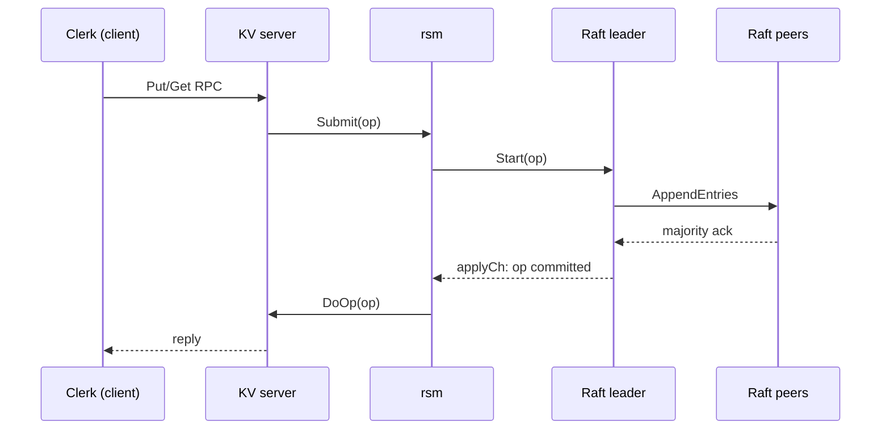
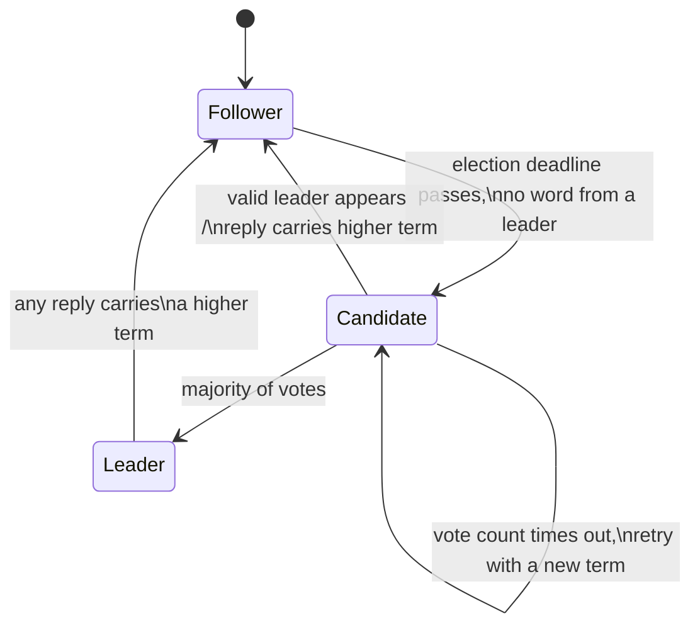

# raft-kv

A fault-tolerant, linearizable key/value store in Go, built on my Raft
implementation.

The project has three layers:

- `raft/`: leader election, log replication, persistence, and snapshots.
- `rsm/`: a replicated-state-machine bridge that turns Raft's async log into
  a blocking service API.
- `kv/`: a versioned key/value store that routes reads and writes through the
  replicated log.

This repository is the public, policy-safe version of the project. The original
MIT 6.5840 test harness, handout code, RPC framework, and tests are not
included. The implementation files are my own work.

## Start Here

This README is the front door. It explains what the project is and how the
pieces fit together.

For different levels of review:

- [Reviewer Guide](REVIEWER_GUIDE.md): the fast path through the repo, useful
  if you want to evaluate the project in 5-10 minutes.
- [Deep Dive](DEEP_DIVE.md): the full chaptered writeup: elections,
  replication, persistence, snapshots, the rsm layer, KV linearizability, and
  the debugging stories behind the implementation.

The split is intentional. A reviewer should not need to read a book to find the
important files. But the book should still exist, because the hard part of this
project was not only writing Raft; it was understanding why each rule exists.

## Quick Demo

The public demo is intentionally small. It is not a replacement for the private
course harness. It is a standalone check that the cleaned repository can elect a
leader, commit operations, survive a leader kill, and continue serving requests.

```sh
go run ./cmd/demo
```

Example output:

```text
started 3-node cluster
leader elected: S1 term 1
put x=1 -> ok
get x -> value=1 version=1
killed leader S1
new leader elected: S2 term 2
put x=2 -> ok
get x -> value=2 version=2
```

## What This System Guarantees

The goal is **linearizability**. Linearizability means every completed client
operation appears to happen at one instant between its call and its return, even
though the system is actually running across multiple machines.

For a key/value store, that means:

- once a `Put` succeeds, later reads must see it or a later write;
- two racing writes are ordered in one global history;
- a server in an old term cannot serve stale reads just because its local map
  still looks valid.

Raft gives the system one committed log. The KV service applies that log in
order. That is how several machines behave like one database.

## System At A Glance

Before the diagram, here are the important nouns.

**Clerk**: the client-side library. It does not know who the leader is, so it
tries servers until one gives a real answer.

**KV server**: the service layer. It receives `Get` and `Put` RPCs, but it does
not mutate the map directly from the handler.

**rsm**: the replicated-state-machine layer. It submits an operation to Raft,
waits until the operation commits, applies it to the service, and wakes the
waiting handler.

**Raft**: the consensus layer. It elects one leader, replicates log entries to a
majority, persists the state needed for crash safety, and compacts old log
entries into snapshots.

A request flows down through those layers and comes back up only after it is
committed:



The important detail is that `Get` also goes through this path. A stale leader
may still have a local map, but it cannot commit new log entries without a
majority. Routing reads through Raft prevents that stale leader from returning
old data.

## Raft In One Picture

Raft servers are always in one of three roles.

**Follower**: accepts valid leader messages and votes in elections.

**Candidate**: starts an election after its election timeout expires.

**Leader**: owns client log appends for the current term and replicates them to
followers.

Terms are the system's logical clock. A higher term means "your view of the
cluster is stale." Any server that sees a higher term steps down to follower.



The bugs in this project mostly came from violating that picture in subtle
ways: stale replies updating current state, old leaders acting after a new term,
or timers causing healthy followers to start disruptive elections.

## Code Map

The files worth reading first:

```text
raft/raft.go
    Raft core: elections, AppendEntries, persistence, snapshots, applier.

raftapi/raftapi.go
    Public interface between Raft and the layers above.

rsm/rsm.go
    Converts Raft's Start/applyCh API into Submit(op) -> result.

kv/client.go
    Clerk retry logic, leader hunting, and ErrMaybe handling.

kv/server.go
    Versioned key/value state machine and RPC handlers.
```

## Core Design Ideas

### 1. A Reply Is Still A Message

In a synchronous program, a reply feels like the end of something. In Raft, a
reply is just another network message. It can be delayed, duplicated, or arrive
after the sender has lost leadership.

That is why reply handlers check the term and role before mutating state. A
leader should only apply an AppendEntries reply if it is still the same leader
term that sent the request.

This rule prevents old RPCs from corrupting new leadership state.

### 2. Persist Before Publishing

Raft persists `currentTerm`, `votedFor`, and the log. After snapshots, the
snapshot bytes are durable history too.

The key rule is:

```text
No other server may observe a state change until that state change is on disk.
```

For example, if a server grants a vote, replies, crashes, and reboots without
remembering that vote, it may vote twice in the same term. That can elect two
leaders. So the vote must be persisted before the reply escapes.

### 3. Delete Log Entries Only On Conflict

An AppendEntries RPC can arrive late. A shorter old RPC may describe a prefix of
the leader's log even after the follower has already accepted newer entries.

So the follower cannot blindly truncate and append. It walks entry by entry:

- if the slot is missing, append the rest;
- if index and term match, keep walking;
- if index matches but term differs, truncate at the conflict and append.

This preserves committed entries when stale but valid prefix messages arrive
out of order.

### 4. Snapshots Need An Offset

After snapshotting entries 1 through 1000, global log index 1005 no longer
lives at slice position 1005. The implementation keeps a sentinel entry at
`log[0]`:

```text
log[0].Index = lastIncludedIndex
log[0].Term  = lastIncludedTerm
```

Then:

```text
slice position = global index - log[0].Index
```

The sentinel turns snapshot offset arithmetic into one consistent translation
instead of scattered special cases.

### 5. ErrMaybe Is Honesty, Not Weakness

Suppose a client sends `Put(k, v, version=3)`. The leader commits it and bumps
the key to version 4, but the reply is lost. The client retries the same Put
with version 3 and receives `ErrVersion`.

Did this client's first Put succeed, or did another client write first?

From the client's point of view, both histories are possible. Returning
definite success would lie in one history. Returning definite failure would lie
in the other. `ErrMaybe` is the API admitting that the outcome is unknowable
from the available evidence.

## Validation

The private implementation was tested against the MIT 6.5840 harness before the
public cleanup. That harness is not included here.

The public repository carries policy-safe validation:

```text
go run ./cmd/demo        # leader election, failover, Put/Get
go test ./...            # public tests
go test -race ./...      # race detector on public tests
```

The deep dive explains the private gauntlet methodology: repeated runs,
controlled parallelism, failure-rate measurement, and timing fingerprints.
Those details matter because many of the real bugs were statistical. A single
passing run was not treated as proof.

## Deep Dive Outline

The full writeup is in [DEEP_DIVE.md](DEEP_DIVE.md). Its chapters are:

1. **Leader election**: terms, randomized deadlines, vote rules, and the 14%
   flake caused by not resetting a candidate's timer.
2. **Log replication**: AppendEntries, conflict-only truncation, stale replies,
   current-term-only commit, and fast backup.
3. **Persistence**: what must survive a crash and why persistence is about
   publishing promises.
4. **Snapshots**: log compaction, the sentinel entry, snapshot persistence, and
   InstallSnapshot.
5. **Replicated state machine**: turning `Start` and `applyCh` into a blocking
   `Submit` call.
6. **Key/value linearizability**: versioned writes, leader hunting, reads
   through Raft, and `ErrMaybe`.
7. **Testing and debugging**: the 100-run harness, stale binaries, false
   positives in scripts, latency histograms, and how the bugs were found.

## Policy Note

This project was built while working through MIT 6.5840. The public repository
does not include MIT-provided tests, harness code, handout scaffolding, PDFs, or
RPC/persistence libraries. The original complete archive remains private.

The purpose of this repository is to present my implementation, my debugging
history, and my explanation of the system in a form that is safe to publish.
